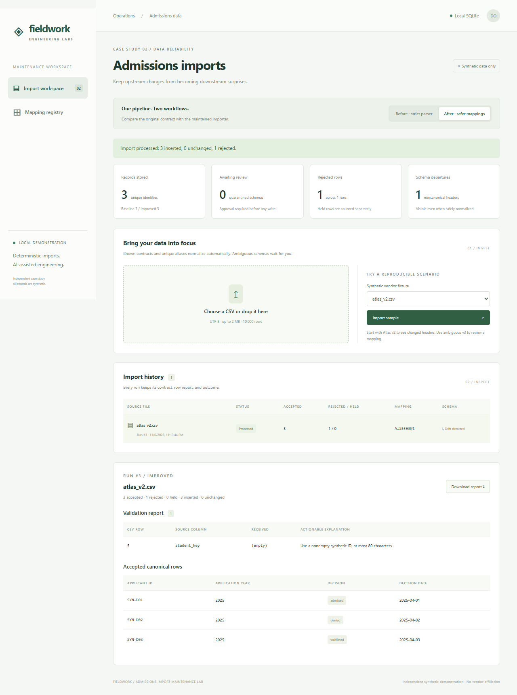

# Admissions CSV Import Maintenance Lab

An admissions admin imports historical CSV exports. A single-vendor parser works until headers, decision spellings, or date formats change. This lab shows the original workflow, reproduces its coverage gap, and adds deterministic mappings, actionable errors, and operator review.

**Independent, synthetic, portfolio-company-inspired demonstration. This is not a Beacon production change.** No real students, schools, credentials, admissions predictions, hosted AI, or runtime LLM calls.



## Verified outcome

Identical six-file dataset: 19 rows, 15 valid, four invalid. After one simulated operator approval:

| Measure | Baseline | Improved |
|---|---:|---:|
| Valid rows imported | 3 / 15 | 14 / 15 |
| Valid rows rejected | 12 | 0 |
| Valid rows held for review | 0 | 1 |
| Initial required schema-correction events | 5 | 2 |
| Invalid rows rejected | 4 / 4 | 4 / 4 |
| Schema departures visibly surfaced | 5 / 5 | 5 / 5 |
| Incorrect silent canonical mappings | 0 | 0 |
| Record growth on exact replay | 0 | 0 |
| Supported-format regression criteria met | 1 / 4 | 4 / 4 |

The unknown file deliberately remains quarantined. Correction events count distinct schemas requiring a mapper change or configuration approval, not clicks, minutes, or actual support tickets. Only one improved approval was executed. See [methodology and limitations](docs/03-results.md), [raw benchmark](evidence/benchmark.json), and [case study](portfolio/case-study.md).

## Setup on Ubuntu / WSL

Prerequisites: Python 3.11+ with `venv`, Node 22.12+ (or Node 24), npm, and Git. Run from this repository root. No Docker or credentials needed.

```bash
python3 -m venv .venv
source .venv/bin/activate
python -m pip install -r backend/requirements.txt
npm --prefix frontend ci
# Install Chromium and its Linux OS dependencies for Playwright:
cd frontend
npx playwright install --with-deps chromium
cd ..
```

If Ubuntu lacks venv: `sudo apt-get update && sudo apt-get install -y python3-venv`. The captured verification ran on Windows 11, Python 3.13.14, Node 24.22.0, using installed Chrome. Linux commands are provided for handoff; Linux execution is not claimed.

## Reset, seed, and run

Stop the demo servers before resetting. This deletes only the selected repository-local SQLite file and its journal files, then seeds fixed fictional CSVs. Run it again to return to the same dataset and pending-review state. IDs and counts are repeatable; timestamps reflect each reset.

```bash
./scripts/reset-demo.sh
# Expected: 12 runs, 15 stored records total
# Baseline: 3 records. Improved: 12 records, 2 quarantined schemas.
python -m uvicorn backend.main:app --host 127.0.0.1 --port 8002
```

In a second terminal, from this repository root:

```bash
npm --prefix frontend run dev
```

Open **http://127.0.0.1:5174**. API docs: **http://127.0.0.1:8002/docs**. SQLite lives at `backend/demo.sqlite3`; backend `IMPORT_DB` may select another file. Reset uses an explicit repository-local path: `./scripts/reset-demo.sh --database backend/demo.sqlite3`. For a blank demo: `./scripts/reset-demo.sh --empty`. The portable equivalent is `python scripts/reset.py`.

## Essential demo

1. In **Before · strict parser**, open `atlas_v1.csv` in history: 3 accepted, 1 invalid year. Open `atlas_v2.csv`: schema rejected.
2. In **After · safer mappings**, open `atlas_v2.csv`: 3 accepted through `Aliases@1`, one precise `student_key` error. Inspect Birch and Cedar date normalization too.
3. Open `ambiguous_v3.csv`. No records are written. Compare application and graduation years. Select `application_year`, retain the ISO date contract, confirm ignored `graduation_year`, and approve. Improved records increase from 12 to 14.
4. Import that fixture again: exact replay, same run, no additional records. Inspect **Mapping registry** for version, source columns, ignored columns, and reviewer.
5. Leave `unknown_v1.csv` held. Missing information still requires a person. Download any run's JSON report for support.

The UI uploads files or loads repository fixtures; every dashboard count comes from SQLite/API state. The [presenter script](docs/demo-script.md) includes expected state transitions and failure explanations.

## Run checks and reproduce evidence

Stop both demo servers first: Playwright owns ports **8002** and **5174**, refuses to reuse another server, and resets only `backend/e2e.sqlite3`.

```bash
source .venv/bin/activate
python scripts/verify.py
```

That runs all five checks below and saves actual commands, exit codes, and output in `evidence/verification.json`:

```bash
python -m pytest backend/tests -q --junitxml=evidence/backend-tests.xml
npm --prefix frontend run typecheck
npm --prefix frontend run build
python scripts/benchmark.py
npm --prefix frontend run test:e2e
```

For baseline diagnosis only: `python scripts/diagnose.py`. Benchmarking creates/removes a temporary SQLite database **inside `evidence/`**; it does not change the seeded demo. It hashes fixtures, checks canonical values against the declared oracle, exercises both workflows through the API, approves only the ambiguous fixture, and replays every file. The smoke test captures six screenshots and `evidence/playwright-results.json`. Current checks: **55 backend tests passed; typecheck/build passed; 3 Playwright tests passed; strengthened benchmark assertions passed**. The [CI-002 fixes](docs/07-review-fixes.md) add canonical coverage checks and prevent workflow switches during pending imports; fresh logs are preserved separately in `evidence/ci-002/`. The [follow-up audit](docs/06-review.md) records a malformed-year correction and its failing-before/passing-after evidence.

If using an already installed Chrome instead of bundled Chromium:

```bash
PLAYWRIGHT_CHANNEL=chrome python scripts/verify.py
```

The final validation used that option after the bundled browser download hit a full system drive. The Python TestClient emits a Starlette `httpx` deprecation warning; requests/tests pass. The check runner handles Windows console Unicode as well as Linux output.

## Contracts and persistence

- Four required canonical fields: `applicant_id`, application `year` (2000–2100), `decision` (`admitted`, `denied`, `waitlisted`), and `decision_date` (normalized ISO date). IDs are nonempty, at most 80 characters. No PII needed.
- `backend/mappings.json` configures Atlas, Birch, Cedar, alias rules and versions. Exact normalized header signatures take priority; unique complete aliases use ISO dates. Unknown, extra, or ambiguous columns require review. Duplicate/blank normalized headers fail. Graduation year is review-only, even if it is the only year column.
- An approval must map all four fields to distinct existing source columns, specify an allowlisted date format, identify a reviewer, and explicitly list every ignored source column. Registry insert, validation, record writes, and run update commit together. Invalid approval writes nothing. Later files with that exact signature reuse the contract.
- File replay identity: SHA-256 of exact bytes + workflow. Renaming a file does not bypass replay. Reordering rows/changing line endings can create a new run; record uniqueness still prevents duplication.
- Record identity: `(workflow, applicant_id, year)`. IDs are assumed to be globally stable across these fictional exports; they are case-sensitive. Exact record matches are unchanged. Improved conflicting decision/date values are rejected; first stored values survive. There is no last-write-wins update or inferred student matching. Baseline preserves existing values on duplicate identity but does not diagnose conflicts.
- `accepted` means valid, conflict-free rows, including unchanged records; `inserted` is new records; `rejected` is invalid rows; `held` is unprocessed quarantined rows. Errors may contain multiple entries per row. CSV row numbers count parsed CSV records including the header (quoted multiline cells remain one record).
- Runs preserve raw synthetic bytes, reports, mapping configuration and UTC timestamps. Approved schemas retain reviewer/time/version. Exact replays return original counts and `replayed: true`; original inserted counts are historical, not a claim of new writes. Reprocessing is explicit and limited to quarantined runs.

## Code map and handoff

| Path | Purpose |
|---|---|
| `backend/parser.py` | Preserved executable strict baseline and shared basic validators |
| `backend/normalizer.py`, `backend/mappings.json` | Detection, declarative normalization, row explanations |
| `backend/main.py`, `backend/db.py` | Upload/review/reprocess API, transactional records and registry |
| `frontend/src/main.tsx`, `Review.tsx`, `models.ts` | Workspace, review form, API-facing types |
| `backend/tests/`, `frontend/e2e/import.spec.ts` | Vendor, validation, concurrency, approval and browser regressions |
| `scripts/` | Diagnosis, benchmark, reset/seed, verification |
| `docs/01-baseline.md` through `docs/05-tradeoffs.md` | Phase evidence, engineering process, maintenance decisions |
| `portfolio/case-study.md`, `evidence/` | Hiring-manager narrative and reproducible artifacts |

Git phase gates: `615da24` (`baseline-demo`) → `33f5cdf` diagnosis → `0b8aa19` improvement. `git show baseline-demo:backend/parser.py` inspects the original parser. The tag is unchanged; follow-up commit `a63eb3b` hardens shared year validation in both current workflows, so current baseline mode differs from the tag on oversized numeric years. The benchmark fixture outcomes remain unchanged. There is no runtime AI dependency. [AI engineering process](docs/04-ai-engineering-process.md) distinguishes development assistance, ordinary automation, and human responsibilities. [Tradeoffs and maintenance](docs/05-tradeoffs.md) explains how to extend this safely.

## Troubleshooting and boundaries

| Symptom | Action |
|---|---|
| UI reports backend unavailable / proxy error | Start Uvicorn at 8002, then reload 5174; check `curl http://127.0.0.1:8002/api/health`. |
| Port already in use / Playwright refuses startup | Stop the existing demo process with Ctrl-C. Tests intentionally do not share a running service. |
| `No module named backend` | Run Python commands from repository root with the venv active. |
| Reset permission/SQLite lock error | Stop both servers, then reset. Do not reset a running database. |
| Replay stays quarantined after another approval | Open the run and click **Retry with approved mappings**. An exact reupload returns the historical run. |
| 409 on approval | The run was already processed or another run approved this signature; reload or reprocess. |
| 413 / 422 response | Check 2 MB, 10,000 rows, UTF-8, valid quoting, required fields, and declared date format. |
| Missing browser / Linux shared libraries | Run `npx playwright install --with-deps chromium` inside `frontend`; installed Chrome can use the channel option above. |
| Browser download says ENOSPC | Provide disk space or use an existing Chrome. Do not infer that browser tests passed without running them. |

This is a loopback-only admin demo without authentication, roles, pagination, migrations framework, background jobs, or record reconciliation UI. A schema signature cannot detect a vendor silently changing semantics while keeping the same headers. Reviewer text is an audit label, not verified identity. Bounds limit parser reads/rows, not total HTTP ingress before multipart handling. Raw files stay local until reset. These limitations are intentional and documented; production hardening and semantic contract changes require engineering ownership.
