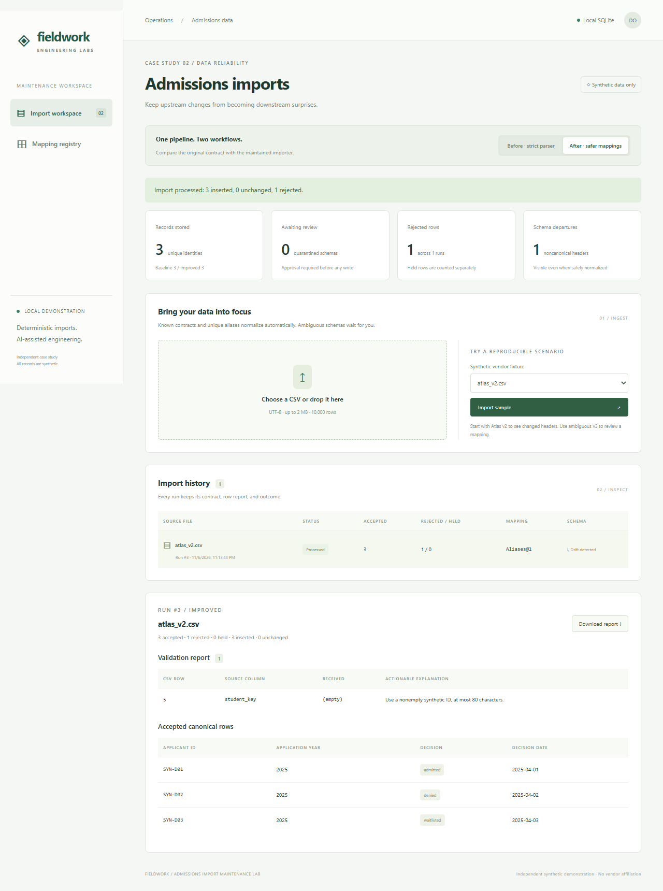

# Modernizing a Fragile Import Pipeline with AI-Assisted Diagnosis, Safer Mappings and Regression Testing

An admissions operations team imports historical CSV exports. The original workflow validates one known contract and shows accepted rows, rejected rows and import history. A vendor changes column names, decision spelling or date format, and support must reproduce the failed import before engineering can update the mapper.

This independent, synthetic, portfolio-company-inspired demonstration models that maintenance work. It does not use Beacon systems, customer records, real schools or admissions predictions.

## The original process and bottleneck

The strict importer is working software: Python's CSV reader, basic field validation, SQLite persistence, a React admin UI and replay protection. Atlas v1 imports three valid rows and rejects an out-of-range year. The changed Atlas export contains three valid rows too, but the unfamiliar header contract rejects the file before row validation. Birch and Cedar add different headers and date contracts.

The support diagnosis is repeatable: compare sample CSVs, inspect the strict header check and review the error output. Across six fixed files, only 3 of 15 valid rows are accepted. Five schemas require a mapper correction. The baseline is committed as `615da24` and tagged `baseline-demo`; its parser remains executable in the final app.

## The engineering change

Codex examined the synthetic files, parser, schema, baseline tests and generated error report. It helped implement the smallest useful separation: declarative schema detection and normalization before ordinary row validation.

Known vendor signatures use versioned field/date contracts. Unique, complete aliases handle the changed Atlas export. Unknown or ambiguous columns go to quarantine, where an operator can compare source samples, select fields, specify the date format and explicitly acknowledge ignored columns. Approval persists a reusable mapping version and validates the rows in the same transaction. The importer never calls an LLM.

The UI makes the operational change visible: before/after modes, live SQLite counts, history, schema-departure markers, mapping versions, source-column errors, canonical accepted rows, JSON reports and an approval log. Exact file replay returns the existing run. Record identity constraints prevent duplicates across different files, and conflicting decisions are reported rather than overwriting stored values.

Engineering review rejected guessing unknown fields, heuristic date interpretation and last-write-wins updates. It also caught a subtle alias risk: a graduation year must require review even when it is the only year column. A regression now enforces that boundary. Review here was Codex-assisted inspection and executable checks; no independent human review or human-only comparison is claimed.

## What changed in the measured workflow

The benchmark submits identical fixture bytes through both API workflows into an isolated SQLite database, checks full canonical rows against a declared oracle, approves one ambiguous schema and replays every file. Sample: six files, 19 rows, 15 valid and four invalid.

| Outcome | Before | After |
|---|---:|---:|
| Valid rows imported | 3 / 15 | 14 / 15 |
| Valid rows rejected / held | 12 / 0 | 0 / 1 |
| Initial required schema-correction events | 5 | 2 |
| Supported-format regression criteria met | 1 / 4 | 4 / 4 |
| Invalid rows rejected | 4 / 4 | 4 / 4 |
| Schema departures surfaced | 5 / 5 | 5 / 5 |
| Incorrect silent canonical mappings | 0 | 0 |
| Record growth after replay | 0 | 0 |

One correction event is one distinct schema needing a code mapper change or configuration approval, not a click or unit of human time. The benchmark executes one improved approval and leaves the unknown schema unresolved. Before that approval, the improved importer accepts 12/15 valid rows and holds three. The final 14/15 result depends on that explicit reviewed configuration.

The original handoff passed 31 backend tests. A [follow-up review](../docs/06-review.md) reproduced oversized numeric years aborting imports and causing an unhandled approval error. Shared validation now rejects those rows while accepting valid peers; this hardening also changes current baseline mode on that edge case, while the baseline tag remains intact. All 44 current backend tests and two Playwright smoke tests pass, as do TypeScript checking and the production build; benchmark metrics are unchanged. The browser scenarios exercise baseline failure, normalized success, precise errors, quarantine, approval, replay, registry and mobile layout. Screenshots come from a smaller live smoke sequence, so their counts differ from the complete benchmark. Captured validation ran on Windows with installed Chrome after an earlier bundled browser download ran out of disk space.

## AI's role and the limits of this result

AI assistance helped with code exploration, comparing schema differences, implementation, test generation, edge-case review and troubleshooting. Runtime detection, validation, persistence and regression checks are deterministic automation. People still determine vendor field meanings, approve ignored columns and reconcile changed source records.

The measured improvement is coverage and fewer required schema interventions on these fixtures. Invalid-row rejection, drift detection and replay safety were already working and did not improve numerically. No engineering-time savings, support-ticket reductions, productivity multiplier or runtime speedup was measured. The exercise does not isolate AI as a causal experimental variable.

This is a bounded local admin tool. It lacks authentication, production retention controls and audited mapping replacement. Identical headers with changed semantics can evade signature detection; real vendor identity and contract governance would be needed. Six hand-authored files do not establish interoperability or reliability at enterprise scale. One unknown schema deliberately remains held instead of being guessed.

## What a small team receives

The handoff includes inspectable mappings and fixtures, regression tests, a reset/seed command, a reproducible benchmark, browser evidence and an operational demo script. Adding a vendor follows a clear loop: reproduce with synthetic data, confirm semantics, extend the declarative contract, assert canonical values and error messages, then run the checks.

- [Quickstart and commands](../README.md)
- [Baseline](../docs/01-baseline.md) and [support diagnosis](../docs/02-diagnosis.md)
- [Exact results and limitations](../docs/03-results.md), [raw benchmark](../evidence/benchmark.json), [executed verification](../evidence/verification.json)
- [AI engineering process and reviewed decisions](../docs/04-ai-engineering-process.md)
- [Tradeoffs and maintenance guidance](../docs/05-tradeoffs.md), [presenter script](../docs/demo-script.md)
- [Normalizer](../backend/normalizer.py), [declarative mappings](../backend/mappings.json), [backend regressions](../backend/tests/test_improvement.py), [browser smoke](../frontend/e2e/import.spec.ts)

A [second targeted follow-up](../docs/07-review-fixes.md) strengthens benchmark multiset/persisted-record assertions and prevents delayed import responses from mixing workflow views. Current verification passes 55 backend tests and 3 browser tests, typecheck/build and the strengthened benchmark; the operational results and dataset denominators above are unchanged. Historical evidence is retained separately from the new red/green execution logs.
